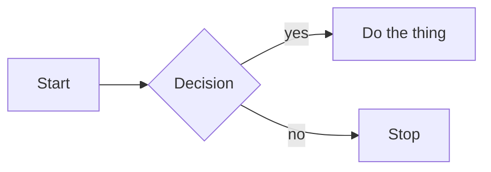
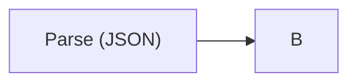
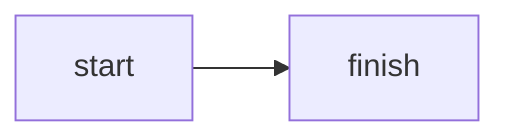

# Mermaid Diagrams — Authoring & Review Skill

Mermaid is a diagrams-as-code language whose diagrams live inside fenced
` ```mermaid ` blocks in Markdown. Well-written Mermaid is small, unambiguous,
renders the same on every supported host, and reads almost as well as prose.
Badly written Mermaid silently breaks on one host, works on another, and
grows into a wall of arrows that nobody can maintain.

This skill makes an agent good at two things:

1. **Authoring** a Mermaid diagram inside a Markdown document from a user's
   natural-language intent.
2. **Reviewing and fixing** an existing ` ```mermaid ` block: syntax,
   semantics, accessibility, and host compatibility.

It does **not** cover local rendering or CI validation of diagrams
(no `mermaid-cli`, no headless-browser checks). Validation here means
structural review by the agent against the rules in this skill.

---

## When to Use This Skill

Activate this skill when the user asks you to do any of the following:

- Add a diagram to a Markdown document (README, docs site, issue, PR
  description, ADR, design note).
- Turn a textual description of a process, interaction, schema, state machine,
  schedule, hierarchy, or timeline into a diagram.
- Fix, clean up, or review a ` ```mermaid ` block that already exists.
- Pick between Mermaid diagram types for a given idea.
- Configure theming, `%%{init}%%` directives, or accessibility for a Mermaid
  diagram.
- Make an existing Mermaid diagram render correctly on GitHub, VS Code, MkDocs
  (Material), or Docusaurus.

### Non-triggers — do NOT use this skill

| Request | Why it doesn't fit | Instead |
|---|---|---|
| "Draw this with PlantUML" | Different tool and syntax | Decline; or offer to translate to Mermaid if acceptable |
| "Generate a PNG architecture diagram" | Image generation, not diagrams-as-code | A drawing/image tool |
| "Create a Graphviz `.dot` file" | Different DSL | Graphviz-specific guidance |
| "Validate my mermaid diagrams in CI" | Tooling/rendering, not in this skill's scope | Point to `mermaid-cli` docs directly |

---

## The Universal Embed Pattern

Every Mermaid diagram in Markdown uses this exact skeleton:

````markdown

````

Rules that apply to every diagram type:

1. The fence is exactly `` ```mermaid `` (lowercase, no spaces).
2. The **first non-comment, non-directive line** must be the diagram-type
   header: `flowchart LR`, `sequenceDiagram`, `classDiagram`, `stateDiagram-v2`,
   `erDiagram`, `gantt`, `mindmap`, `timeline`, `C4Context`, etc.
3. An optional `%%{init: { ... }}%%` directive must come **before** the
   header line.
4. `accTitle` and `accDescr` (when supported by the diagram type) go
   immediately after the header.
5. Indentation inside the block is stylistic — Mermaid does not care about
   indent width, but consistency helps reviewers.
6. Never mix two diagram types inside one block. One idea per diagram.

---

## Picking the Right Diagram Type

Use this decision tree. Defer to
[`references/diagram-types.md`](references/diagram-types.md) for the full
matrix and one-line examples per type.

| User's intent | Diagram | Mermaid header |
|---|---|---|
| Branching process, pipeline, decision flow | Flowchart | `flowchart LR` / `TD` |
| Ordered interaction between actors/services over time | Sequence | `sequenceDiagram` |
| Object-oriented structure, types and their relationships | Class | `classDiagram` |
| Lifecycle, modes, finite state machine | State | `stateDiagram-v2` |
| Data model, tables and cardinalities | ER | `erDiagram` |
| Schedule, milestones, task dependencies | Gantt | `gantt` |
| Hierarchy rooted at one idea | Mindmap | `mindmap` |
| Chronological events along an axis | Timeline | `timeline` |
| System context / containers / components | C4 | `C4Context` (or `C4Container`/`C4Component`/`C4Dynamic`) |

If two types fit, prefer the one that best matches the **primary axis of the
idea** — time → sequence/timeline/gantt; structure → class/ER/C4; behaviour →
state/flowchart; hierarchy → mindmap.

---

## Core Authoring Principles

Follow these numbered rules when writing any Mermaid diagram:

1. **One diagram, one idea.** If the diagram needs a paragraph of caveats to
   make sense, split it into multiple diagrams or move detail into prose.

2. **Pick a direction deliberately.** `LR` (left-to-right) reads well in wide
   documentation pages; `TD` / `TB` (top-down) reads well on narrow pages and
   in issue comments. Be consistent within a document.

3. **Short IDs, human-readable labels.** Use short ASCII IDs like `A`, `svc`,
   `db` and put the prose in labels: `svc["Order service"]`. IDs appear in
   edge definitions; long IDs make edges unreadable.

4. **Quote labels whenever in doubt.** Any label with spaces, punctuation, or
   reserved words (`end`, `subgraph`, `click`, `direction`, `class`) must be
   quoted: `A["Some (tricky) label"]`.

5. **Escape problem characters.** Parentheses, `<`, `>`, `#`, and `"` inside
   labels need either quoting (`"…"`) or HTML entities (`&lt;`, `&gt;`,
   `&quot;`, `&#35;`). Unescaped `(` inside an unquoted flowchart label is
   the single most common breakage.

6. **One edge style per diagram family.** Don't mix `->>`, `-->>`, and `-x`
   arrow variants at random — each means something specific inside its
   diagram type (see per-type references).

7. **No type mixing.** A single ` ```mermaid ` block has exactly one diagram
   header. If you need a sequence diagram and a flowchart, use two blocks.

8. **Accessibility is not optional.** Any non-decorative diagram gets an
   `accTitle` and an `accDescr`. See
   [`references/accessibility.md`](references/accessibility.md).

9. **Theming is last, not first.** Start with the default theme. Only reach
   for `%%{init}%%`, `theme`, `look: handDrawn`, or custom `themeVariables`
   when the default is actually insufficient. See
   [`references/theming-and-config.md`](references/theming-and-config.md).

10. **Size budget.** Aim for ≤ ~20 nodes in a flowchart, ≤ ~8 participants
    in a sequence diagram, ≤ ~12 states in a state diagram. Past that,
    diagrams stop being useful — split them.

---

## Authoring Workflow

Follow this procedure when creating a Mermaid diagram from a user's request.

### Step 1 — Clarify intent

What is the diagram trying to communicate? Process? Interaction? Structure?
Lifecycle? If the user's request is ambiguous (e.g. "diagram our auth flow"),
pick the best fit and state it explicitly in your reply, or ask one focused
question.

### Step 2 — Pick the diagram type

Use the table above and [`references/diagram-types.md`](references/diagram-types.md).
If in doubt, default to `flowchart LR` — it's the most widely supported and
the most forgiving.

### Step 3 — Sketch nodes and edges in plain text

Before writing Mermaid, list the participants/nodes/states and the relations
between them in prose. This catches missing pieces before syntax gets in the
way.

### Step 4 — Write a minimal valid block

Start with the header line and the smallest set of nodes/edges that captures
the idea. Keep IDs short. No styling yet.

### Step 5 — Add labels, grouping, and styling

- Quote any label that needs it.
- Add `subgraph`s / `box`es / `namespace`s only when grouping clarifies the
  diagram.
- Reach for `classDef` + `class` for styling rather than inline styles.

### Step 6 — Add accessibility

Add `accTitle` and `accDescr` lines (where the diagram type supports them).
If the diagram type does **not** support them (e.g. `mindmap`, `timeline` on
older versions), put an equivalent summary in the surrounding Markdown prose
immediately before the block.

### Step 7 — Verify against target host(s)

Cross-check the block against host quirks in
[`references/rendering-hosts.md`](references/rendering-hosts.md):

- **GitHub** — strictest; no external JS; `%%{init}%%` is allowed but
  `securityLevel: 'loose'` is ignored.
- **VS Code** — requires a Mermaid preview extension.
- **MkDocs Material** — needs `pymdownx.superfences` custom-fence config.
- **Docusaurus** — needs `@docusaurus/theme-mermaid` and
  `markdown.mermaid: true`.

### Step 8 — Run the validation checklist

See below. Only then hand the diagram back.

---

## Review Workflow

When asked to fix or review an existing ` ```mermaid ` block:

### Step 1 — Identify the diagram type

Look at the first non-directive, non-comment line. If it is missing or
misspelled (`flowChart` instead of `flowchart`, `sequenceDialog` instead of
`sequenceDiagram`), that alone can break rendering on GitHub.

### Step 2 — Validate structural shape

For the identified type, check against the relevant `references/<type>.md`
deep-dive file. Each has a "Common mistakes" section with before/after
snippets.

### Step 3 — Scan for universal breakages

- Unescaped `(`, `)`, `<`, `>`, `#`, `"` inside labels.
- `end` used as a node ID (reserved word).
- Arrow kind that doesn't belong to this diagram type (e.g. `-->>` in a
  flowchart).
- Missing `end` to close a `subgraph`, `alt`, `opt`, `loop`, or composite
  state.
- Trailing semicolons where they aren't needed (they're tolerated in
  flowcharts but noisy — prefer consistency).
- Multiple diagram headers in one block.

### Step 4 — Check host compatibility

Apply [`references/rendering-hosts.md`](references/rendering-hosts.md).
Flag any feature used that the target host does not render (e.g.
`C4Component` on very old MkDocs Mermaid versions, or `handDrawn` on GitHub).

### Step 5 — Check accessibility

`accTitle` and `accDescr` present on supported types? If not, add them or
add a prose summary.

### Step 6 — Propose a minimal fix

Show the corrected block and a brief list of what you changed and why. Don't
re-style a diagram the user didn't ask to re-style — fix what's broken and
leave the rest.

For a deeper rubric, see
[`references/review-checklist.md`](references/review-checklist.md).

---

## Common Gotchas

These are the mistakes that keep coming back. Avoid them.

### ❌ Unescaped `(` inside a flowchart label

```mermaid
flowchart LR
    A[Parse (JSON)] --> B
```

The `(` opens a second shape and breaks the parser. Fix by quoting:



### ❌ Using `end` as a node ID

`end` is reserved (it closes `subgraph` blocks). Rename the node:



### ❌ Wrong arrow for the diagram type

- Flowchart: `-->`, `---`, `-.->`, `==>`.
- Sequence: `->`, `-->`, `->>`, `-->>`, `-x`, `--x`.
- Class: `<|--`, `*--`, `o--`, `-->`, `..>`, `<..`.
- State: `-->`.
- ER: `||--o{`, `||--|{`, `}o--o{`, etc.

Mixing these across diagram types produces silent mis-rendering.

### ❌ GitHub renders differently from the live editor

The live Mermaid editor is more permissive. If a diagram works there but not
on GitHub, suspect: unquoted labels, `securityLevel: 'loose'` features
(click handlers with JS, HTML in labels), or a diagram type that the pinned
GitHub Mermaid version doesn't support yet.

### ❌ Docusaurus "diagram not rendering"

Docusaurus does not render Mermaid out of the box. The user must install
`@docusaurus/theme-mermaid` and set `markdown.mermaid: true` in
`docusaurus.config.js`. See
[`references/rendering-hosts.md`](references/rendering-hosts.md).

### ❌ MkDocs Material shows raw code

The `pymdownx.superfences` extension needs a custom fence for `mermaid`, and
the Mermaid JS must be pulled in via `extra_javascript`. Without both, the
block renders as a code block, not a diagram.

### ❌ VS Code preview shows nothing

VS Code's built-in Markdown preview doesn't render Mermaid. Install the
Markdown Preview Mermaid Support extension (or equivalent).

### ❌ `%%{init}%%` after the header

The directive must come **before** the diagram-type header, otherwise it is
ignored:

````text
%%{init: {'theme':'dark'}}%%
sequenceDiagram
    ...
````

---

## Validation Checklist

Before handing any Mermaid diagram back, verify each of these:

- [ ] **Correct fence** — `` ```mermaid `` exactly.
- [ ] **Exactly one diagram-type header** on the first non-directive line.
- [ ] **`%%{init}%%` (if present) is on the very first line.**
- [ ] **All labels with special characters are quoted.**
- [ ] **No reserved words used as IDs** (`end`, `subgraph`, `class`,
      `click`, `direction`, etc.).
- [ ] **Arrow/edge syntax matches the diagram type.**
- [ ] **`subgraph` / `alt` / `opt` / `loop` / composite states are closed
      with `end`.**
- [ ] **`accTitle` and `accDescr` present** (or prose summary for types that
      don't support them).
- [ ] **Size is within budget** (see principle 10).
- [ ] **Target host(s) verified** — applied the quirks from
      [`references/rendering-hosts.md`](references/rendering-hosts.md).
- [ ] **One idea per block** — no diagram-type mixing.

---

## Output Template

Use this skeleton as the starting point for every Mermaid diagram embedded
in Markdown:

````markdown
<!-- Optional: one-line prose summary of the diagram, especially if the
     diagram type does not support accTitle/accDescr. -->

```mermaid
%%{init: {'theme':'default'}}%%
<diagram-type-header>
    accTitle: <short title>
    accDescr: <one-sentence description>

    <nodes / participants / entities>

    <edges / relationships>

    %% Optional styling via classDef/class
```
````

---

## References

Deep-dives live in [`references/`](references/):

- [`diagram-types.md`](references/diagram-types.md) — decision matrix and a
  one-line canonical example per covered type.
- Per-type guides: [`flowchart.md`](references/flowchart.md),
  [`sequence.md`](references/sequence.md),
  [`class.md`](references/class.md),
  [`state.md`](references/state.md),
  [`er.md`](references/er.md),
  [`gantt.md`](references/gantt.md),
  [`mindmap.md`](references/mindmap.md),
  [`timeline.md`](references/timeline.md),
  [`c4.md`](references/c4.md).
- [`theming-and-config.md`](references/theming-and-config.md) — `%%{init}%%`,
  themes, `look: handDrawn`, `themeVariables`.
- [`accessibility.md`](references/accessibility.md) — `accTitle` / `accDescr`
  and diagram-choice guidance for a11y.
- [`rendering-hosts.md`](references/rendering-hosts.md) — GitHub, VS Code,
  MkDocs Material, Docusaurus.
- [`review-checklist.md`](references/review-checklist.md) — the structured
  review/fix rubric.

This skill targets **Mermaid v10+**. Features that require a newer minimum
version are flagged in each reference file.
