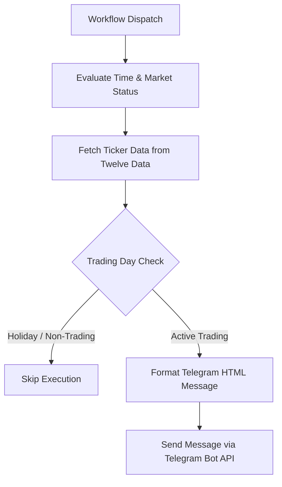

# Workflow documentation: market-us-hourly-update
**Workflow file:** [.github/workflows/market-us-hourly-update.yml](../../.github/workflows/market-us-hourly-update.yml)
**Last reviewed date:** 2026-10-13

## Intro
The `market-us-hourly-update` workflow fetches real-time quote data for key US indices and stocks using the Twelve Data API and formats a rich HTML message sent directly to a Telegram chat. It intelligently handles market hours, distinguishing between intraday updates and market close summaries while skipping non-trading holidays.



## Tutorials

### Running Your First US Market Update
This tutorial guides you through setting up and triggering your first manual US market update in GitHub Actions.

1. **Configure Repository Secrets:** Ensure your GitHub repository has the required secrets configured (`TELEGRAM_TOKEN`, `TELEGRAM_CHAT_ID`, and `TWELVEDATA_KEY`).
2. **Navigate to Actions:** Go to your GitHub repository in your web browser and click on the **Actions** tab.
3. **Select the Workflow:** In the left-hand workflow sidebar, click on **market-us-hourly-update**.
4. **Trigger Manually:** Click the **Run workflow** dropdown button on the right side above the run list, leave the branch on `main` (or your default branch), and click the green **Run workflow** button.
5. **Verify Execution:** Click into the newly started workflow run to observe the PowerShell script execution steps. Once completed successfully, check your designated Telegram chat for the formatted market report.

---

## How-to guides

### How to Add or Remove Tracked Tickers
To modify the list of tracked stocks or ETFs in the market update:
1. Open `.github/workflows/market-us-hourly-update.yml` in your code editor.
2. Locate the `$Indices` array inside the PowerShell step:
   ```powershell
   $Indices = @(
       @{ Name = "DJI (ETF)";     Ticker = "DIA";  Market = "US"; Own = $false }
       ...
   )
   ```
3. Add a new hashtable entry or modify existing entries using the properties:
   - `Name`: Display name shown in the Telegram message.
   - `Ticker`: Valid stock/ETF ticker symbol recognized by Twelve Data.
   - `Market`: Target market identifier (`US`).
   - `Own`: Boolean flag (`$true` or `$false`) determining whether to display the portfolio briefcase icon (`💼`).
4. Commit and push your changes to the repository.

### How to Test Workflow Execution Locally
To test the PowerShell script logic locally on your machine:
1. Set up local environment variables matching the GitHub secrets:
   - `$env:TELEGRAM_TOKEN`
   - `$env:TELEGRAM_CHAT_ID`
   - `$env:TWELVEDATA_KEY`
2. Run PowerShell and execute the script blocks or wrap the inline script into a `.ps1` file for debugging.

---

## Reference

### Triggers
| Trigger Type | Description |
| :--- | :--- |
| `workflow_dispatch` | Triggered externally on schedule via cron-job.org or manually via the GitHub Actions UI. |

### Secrets
| Secret Name | Description |
| :--- | :--- |
| `TELEGRAM_TOKEN` | Bot authentication token provided by BotFather for Telegram API access. |
| `TELEGRAM_CHAT_ID` | Target Telegram chat or channel ID where market update messages are posted. |
| `TWELVEDATA_KEY` | API key for authenticating requests to Twelve Data quote services. |

### Tickers / Instruments Table
| Name | Ticker | Market | Portfolio Owned (`Own`) |
| :--- | :--- | :--- | :--- |
| DJI (ETF) | `DIA` | US | `false` |
| DJUS (ETF) | `IYY` | US | `false` |
| S&P 500 (ETF) | `SPY` | US | `false` |
| MSFT | `MSFT` | US | `true` |
| NOW | `NOW` | US | `true` |
| TSLA | `TSLA` | US | `true` |
| AVGO | `AVGO` | US | `true` |

### Output Fields
| Field / Variable | Type | Description |
| :--- | :--- | :--- |
| `Current` | Number | Rounded closing/current price of the asset from Twelve Data. |
| `DayPct` | Number | Rounded daily percentage change of the asset. |
| `Date` | String | ISO date string (`YYYY-MM-DD`) representing the candle/quote date. |
| `usStatus` | String | Indicates whether the US market is currently `Open 🔔` or `Closed 🔕`. |

### API / Data Sources
| Provider | Endpoint / Method | Purpose |
| :--- | :--- | :--- |
| Twelve Data | `https://api.twelvedata.com/quote?symbol={Ticker}&apikey={Key}` | Fetches real-time quote data, current price, and percentage change. |
| Telegram Bot API | `https://api.telegram.org/bot{Token}/sendMessage` | Delivers the formatted HTML update message to the target chat ID. |

---

## Explanation

### Design Decisions & Reasoning
- **PowerShell on `ubuntu-latest`:** Using PowerShell (`pwsh`) on an Ubuntu GitHub Actions runner allows for robust cross-platform scripting, advanced object manipulation (e.g., hash tables and custom objects), and native JSON handling without relying on complex external shell scripts.
- **Timezone Handling (`Europe/Stockholm`):** Financial hours and message timestamps are evaluated relative to CET/CEST (`Europe/Stockholm`) to align user reporting schedules with local operational expectations.
- **Holiday & Non-Trading Day Detection:** The script compares the latest available candle date (`$CandleDate`) returned by Twelve Data against the current calendar date (`$TodayDate`). If they mismatch (indicating a market holiday or weekend closure where no candles were updated), the script aborts execution gracefully (`exit 0`) to prevent sending stale or misleading updates.
- **Dynamic Formatting:** Depending on whether the US market is actively open, percentage changes are rendered using dynamic emojis (`🟢`/`🔴` during open hours vs. `▲`/`▼` arrows during close/intraday states) and highlighted with Telegram HTML tags.