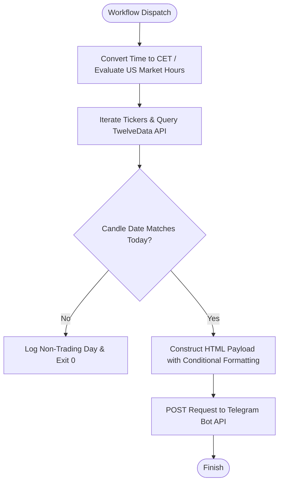

# Workflow documentation: market-us-hourly-update
**Workflow file:** [.github/workflows/market-us-hourly-update.yml](../../.github/workflows/market-us-hourly-update.yml)
**Last reviewed date:** 2026-10-13

## Intro
The `market-us-hourly-update` workflow fetches real-time quote data for key US market indices and specific portfolio stocks via the TwelveData API and publishes an formatted HTML update to a Telegram chat. It runs on a schedule via external triggers (`workflow_dispatch`), dynamically evaluating whether the US market is currently open to format price changes with appropriate symbols (green/red indicators or directional arrows).

## Tutorials

### Getting Started with US Market Updates

This tutorial walks you through setting up, configuring, and executing your first US market hourly update workflow to dispatch stock tracking details to Telegram.

#### Step 1: Configure Repository Secrets
Before running the workflow, you must provide your authentication secrets for Telegram and TwelveData. In your GitHub repository, navigate to **Settings** > **Secrets and variables** > **Actions** and add the following repository secrets:
- `TELEGRAM_TOKEN`
- `TELEGRAM_CHAT_ID`
- `TWELVEDATA_KEY`

#### Step 2: Review Workflow Triggers and Schedule
Open the workflow file located at `.github/workflows/market-us-hourly-update.yml`. Verify that the trigger is set up for external dispatch:

```yaml
on:
  workflow_dispatch:
```

#### Step 3: Trigger the Workflow Manually
1. Go to the **Actions** tab in your GitHub repository.
2. Select the **market-us-hourly-update** workflow from the left sidebar.
3. Click the **Run workflow** dropdown button and trigger the job on your default branch.

#### Step 4: Verify Execution and Output
1. Watch the workflow logs complete on GitHub Actions using the `ubuntu-latest` runner with PowerShell.
2. Check your configured Telegram chat to confirm that the formatted HTML message arrived with index details, current prices, and trading status.

---

## How-to Guides

### Adding a New Ticker or ETF
To track an additional stock or market index:
1. Open `.github/workflows/market-us-hourly-update.yml`.
2. Locate the `$Indices` array block inside the PowerShell script block.
3. Append your new item using the standard hash table structure, designating its display name, ticker symbol, market, and portfolio ownership status (`$true` or `$false`):
   ```powershell
   @{ Name = "NEW"; Ticker = "NEW"; Market = "US"; Own = $true }
   ```
4. Commit and push your changes to the repository.

### Debugging API Connection Failures
If updates fail to deliver or log API error details:
1. Verify that your `TWELVEDATA_KEY` secret is valid and has remaining request quotas.
2. Check GitHub Actions logs to inspect if TwelveData returned a specific error payload (`TwelveData: ...`).
3. Ensure the ticker symbol exists and is supported by TwelveData's quote endpoint.

---

## Reference

### Triggers
| Trigger | Type | Description |
| :--- | :--- | :--- |
| `workflow_dispatch` | Manual / External | Triggered externally on a schedule via cron-job.org or manually via GitHub UI. |

### Secrets
| Secret Name | Description | Required |
| :--- | :--- | :--- |
| `TELEGRAM_TOKEN` | Bot API token for authenticating with Telegram. | Yes |
| `TELEGRAM_CHAT_ID` | Target chat or channel identifier to receive market messages. | Yes |
| `TWELVEDATA_KEY` | API key for fetching real-time financial quotes from TwelveData. | Yes |

### Tickers / Instruments
| Name | Ticker | Market | Portfolio Ownership (`Own`) |
| :--- | :--- | :--- | :--- |
| DJI (ETF) | `DIA` | US | `false` |
| DJUS (ETF) | `IYY` | US | `false` |
| S&P 500 (ETF) | `SPY` | US | `false` |
| MSFT | `MSFT` | US | `true` |
| NOW | `NOW` | US | `true` |
| TSLA | `TSLA` | US | `true` |
| AVGO | `AVGO` | US | `true` |

### Output Fields & Formatting
| Field / Condition | Format / Indicator | Description |
| :--- | :--- | :--- |
| Open Market Change | `+X.X% 🟢` / `-X.X% 🔴` | Percentage change formatted with color-coded circles when the US market is open. |
| Closed Market Change | `+X.X% ▲` / `-X.X% ▼` | Percentage change formatted with directional arrows when the US market is closed. |
| Portfolio Flag | `💼` | Appended to items where `Own = $true`. |
| Error State | `— unavailable ⚠️` | Displayed if fetching data for a ticker throws an exception. |
| Holiday / Non-Trading Day | Skipped (`exit 0`) | Execution terminates early if the latest candle date does not match today's date. |

### API / Data Sources
| Source | Endpoint / Method | Purpose |
| :--- | :--- | :--- |
| TwelveData API | `https://api.twelvedata.com/quote?symbol={Ticker}&apikey={Key}` | Retrieves real-time quote data, current price, percent change, and timestamp. |
| Telegram Bot API | `https://api.telegram.org/bot{Token}/sendMessage` | Dispatches formatted HTML notification messages to the target chat ID. |

---

## Explanation

### Design Decisions and Architecture



#### Timezone & Market Hours Evaluation
The script converts UTC time to `Europe/Stockholm` (CET) to accurately assess local hour, minute, and day of the week conditions. It determines whether the US market is open (`$UsMarketOpen`) based on standard trading hours (Monday through Friday, between 15:30 and 22:00 CET). This separation dictates whether intraday updates use active market indicators or closing stats.

#### Holiday and Non-Trading Day Safeguards
To prevent sending stale data during market holidays or weekends when APIs might return previous session closes, the script extracts the date from the first retrieved candle (`$CandleDate`). If this date differs from the current execution date (`$TodayDate`), the workflow gracefully exits with `exit 0`, preventing unnecessary or misleading notifications.

#### Telegram HTML Presentation
Messages are delivered via PowerShell's `Invoke-RestMethod` utilizing Telegram's `parse_mode = "HTML"`. Bolding, italicizing, and emoji indicators provide a clean, scannable overview optimized for mobile viewing. Portfolio assets are explicitly distinguished using the briefcase icon (`💼`), allowing quick visual auditing of personal holdings.